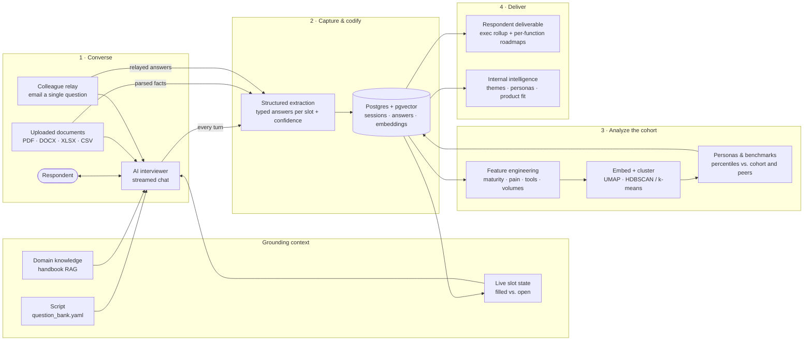

# Knowledge Share Chat

**Turn free-form conversations into structured, benchmarked intelligence.**

An AI interviewer holds a natural, one-question-at-a-time conversation, quietly
captures every answer as typed data, and feeds a growing cohort analytics layer
that clusters respondents into personas, benchmarks each one against peers, and
writes tailored reports for both sides of the conversation.

This repository's flagship application, *Playbook*, is a **sales pre-screen for
finance & accounting teams**. The same engine can be pointed at any purposeful
conversation you want to **capture, codify, and analyze**.

---

## Executive summary

- **The problem.** High-value conversations (discovery calls, intake interviews,
  research sessions) are rich but unstructured. Insight lives in notes and
  memories, is inconsistent between interviewers, and almost never adds up to a
  dataset you can analyze across people.
- **The approach.** A conversational agent works through a configurable
  "script" of information goals, but improvises the wording, asks follow-ups,
  and lets the respondent wander. After every turn, a separate structured-
  extraction step records what was learned against named slots. The chat stays
  human; the data stays clean.
- **The payoff.** Every completed session lands in a shared, append-only cohort.
  Analytics run across that cohort to find personas, size common pain points,
  and benchmark each respondent against peers. Each new session makes every
  benchmark more accurate, so **the dataset compounds in value with use.**
- **The outputs.** A shareable, vendor-agnostic roadmap for the respondent, and a
  restricted internal view for the team running the conversations: ranked
  themes, buying personas, account intelligence, and product-fit mapping.
- **Status.** Working proof of concept, deployed end to end, demonstrated on a
  synthetic cohort of ~150 respondents and a fictional vendor
  (Corbel Analytics). See [Demo vendor & data](#demo-vendor--data).

---

## How it works: from free-form chat to robust analytics



**1 · Converse.** The respondent chats with an AI interviewer that knows *what*
it needs to learn (the script) but not a fixed order or wording. Each turn, the
agent is grounded in three things: which information slots are still open, a
domain knowledge base retrieved by relevance (RAG), and any documents the
respondent has uploaded. Respondents can pause and resume via a magic link, or
forward a single question to a colleague by email.

**2 · Capture & codify.** Every turn makes **two separate model calls**: one
streams the natural reply, and one non-streamed, schema-strict call extracts
typed facts against the script's slots, with a confidence score. Uploaded files
and relayed answers go through the same extraction path. State lives in the
database, not in the prompt, so coverage is always measurable.

**3 · Analyze the cohort.** Answers are rolled up per business function and per
company, turned into numeric features and text embeddings, and clustered into
personas (HDBSCAN with a k-means fallback, projected with UMAP for the cohort
map). An LLM labels each persona. Every entity is benchmarked by percentile
against the whole cohort and against industry/size peers. Runs are
**append-only and timestamped**, so anyone can be compared with the cohort *and
with their own past self*.

**4 · Deliver.** Reports are generated on demand from the stored data, not the
transcript:

| Audience | Deliverable | What's in it |
| --- | --- | --- |
| Respondent | **Company report** | Company profile, cohort benchmark, advisory, quick wins, phased roadmap |
| Respondent | **Function reports** | One roadmap per business function, downloadable |
| Internal team | **Cohort intelligence** | Ranked pain themes, buying personas, market scoping, product-fit mapping, investor narrative |
| Internal team | **Account intelligence** | Opportunity sizing, cluster placement, ideal-customer-profile signals, product fit |

Respondent-facing outputs are **vendor-agnostic by rule**: they recommend
categories of solution, never a single named product. Internal outputs map each
pain theme to *Current product*, *Roadmap candidate*, or *Third-party*, grounded
strictly in a capability document, and never invent capabilities.

---

## Flagship application: sales pre-screen

*Playbook* runs discovery with a finance or accounting leader before a sales
conversation ever happens.

- **For the prospect:** a guided, conversational interview that ends in a
  credible, benchmarked roadmap they can share internally, with no sales pitch
  and no named vendors.
- **For the vendor:** qualified, structured discovery on every account (systems,
  close timeline, team skills, quantified pain, decision context) plus a
  market-level view of which segments are largest and most underserved.
- **The flywheel:** every benchmark shifts as the cohort grows, which creates a
  natural reason to re-engage ("here's how you've moved against your peers"). It
  also produces evidence to justify product investment ("N% of the largest
  cluster has pain Y").

The script covers six areas: company & role context, core accounting processes,
systems & tech stack, team skill levels, pain points, and goals & decision
context. It's tagged with established discovery frameworks (SPIN, MEDDIC, Jobs
to Be Done).

---

## Adapting it to other purposes

The engine is domain-agnostic. Everything specific to the sales pre-screen lives
in configuration and content, not code:

| To change… | Edit… |
| --- | --- |
| What the interviewer needs to learn | [`shared/question_bank.yaml`](./shared/question_bank.yaml): slots, wording intent, priority, order (one file, one reseed command, no redeploy) |
| How the interviewer behaves | [`shared/system_prompt.md`](./shared/system_prompt.md): tone, rules, follow-up style |
| What the interviewer knows | [`knowledge/Playbook_RAG_MDs/`](./knowledge/Playbook_RAG_MDs): the domain handbook it retrieves from |
| What the internal view maps findings to | [`knowledge/vendor_capabilities.md`](./knowledge/vendor_capabilities.md) and `VENDOR_NAME` |
| What gets analyzed and reported | Feature definitions and report sections in `shared/` and `api/` |

Examples of other purposeful conversations it could capture and analyze:

- **Customer & user research:** consistent interviews at scale, with themes and
  segments that emerge across hundreds of sessions.
- **Client onboarding & intake:** collect requirements conversationally and
  hand off a structured profile instead of a form.
- **Employee listening:** onboarding check-ins, stay or exit interviews, and
  engagement pulses, with cohort trends over time.
- **Expert knowledge capture:** interview subject-matter experts and codify
  tribal knowledge into a structured, searchable base.
- **Partner, vendor or due-diligence screening:** standardized assessments
  benchmarked across every counterparty.
- **Program and grant intake, or member needs assessment:** qualify and route
  applicants while building a picture of the whole population.

---

## Design principles

- **Natural for the human, structured for the system.** Chat and extraction are
  separate calls; neither compromises the other.
- **The script is config, not code.** Domain experts can refine the
  questionnaire without an engineer. Slot keys are a stable contract, so
  historical data stays comparable across script versions.
- **State lives server-side.** Coverage, answers and history are in Postgres;
  the prompt gets a compact summary each turn.
- **History is never overwritten.** Cluster runs and benchmarks are
  append-only, which is what makes longitudinal comparison and the compounding
  dataset real.
- **Grounded, not invented.** Reports cite stored data and the capability
  document; validators reject outputs that drift from required structure or
  name forbidden vendors.

---

## Technology at a glance

| Layer | Choice |
| --- | --- |
| Frontend | Next.js 15 (App Router), React, Vercel AI SDK |
| API | Python, FastAPI (chat orchestration, extraction, RAG, reports, relay) |
| Models | OpenAI: streamed chat model, strict structured-output extraction, text embeddings |
| Data | Postgres + pgvector (HNSW indexes) |
| Documents | Docling + pandas parsing, chunked and embedded per session |
| Analytics | scikit-learn, UMAP, HDBSCAN, NetworkX; LLM persona labeling |
| Delivery | Railway (web, api, worker, Postgres), GitHub Actions CI gating every deploy |

---

## Demo vendor & data

The internal (presales) side is written for **Corbel Analytics**, a *fictional*
analytics-automation vendor. Its product is described in
[`knowledge/vendor_capabilities.md`](./knowledge/vendor_capabilities.md), which
grounds the product-fit mapping. Swap that file and `VENDOR_NAME` to point the
system at a real product. The cohort is **synthetic**, generated by
[`scripts/seed_synthetic.py`](./scripts/seed_synthetic.py), so no real
respondent data is included. The demo walkthrough is in
[`docs/demo.md`](./docs/demo.md).

---

# For engineers

[`BUILD_PLAN.md`](./BUILD_PLAN.md) is the original source of truth for scope,
ground rules, and the sequenced backlog.

### Monorepo layout

| Path          | What it is                                                        |
| ------------- | ----------------------------------------------------------------- |
| `web/`        | Next.js 15 (App Router) frontend + thin BFF                       |
| `api/`        | FastAPI: chat orchestration, extraction, RAG, reports, relay      |
| `worker/`     | Python analytics pipeline (cron + manual trigger)                 |
| `shared/`     | Shared Python package (`playbook_shared`): models, question bank  |
| `migrations/` | Forward-only SQL migrations (pgvector + tables)                   |
| `scripts/`    | Reseed, synthetic data, eval scripts                              |

### Toolchain

- **Node** 20+ with **pnpm** (`web`).
- **Python** 3.12 with **uv** (`api`, `worker`, `shared`) — a uv workspace.
- **Postgres + pgvector** (Railway plugin in prod; a local container for tests).

### Local quickstart

```bash
# Python services (from repo root — uv workspace)
uv sync
uv run --package playbook-api uvicorn api.main:app --reload   # http://localhost:8000/health
uv run --package playbook-worker python -m worker.main        # runs and exits 0

# Web
cd web && pnpm install && pnpm dev                            # http://localhost:3000
```

### Database & migrations

Forward-only SQL migrations live in [`migrations/`](./migrations) and are applied
by a small runner (records applied files in a `schema_migrations` table; re-runs
are a no-op). Files named `*.notx.sql` run outside a transaction (for future
`CREATE INDEX CONCURRENTLY`).

```bash
# Set DATABASE_URL (pgvector-enabled Postgres), then:
uv run python scripts/migrate.py            # also the Railway pre-deploy command
```

### Question bank (the editable "script")

The discovery questionnaire lives in one human-editable file,
[`shared/question_bank.yaml`](./shared/question_bank.yaml) (the single source of
truth), and is synced to the `questions` table by an upsert reseed. `slot_key`s
are an **immutable contract** — reword/retier/reorder/retire freely, but never
rename or reuse a key (retire it and add a new one). Editing rules are documented
at the top of the YAML.

```bash
uv run python scripts/reseed_questions.py   # upsert by slot_key; retires missing
```

The conversation engine reads the **active** set from the DB at
runtime, so a reseed takes effect on the next session with no redeploy.

### Tests

```bash
uv run pytest                               # all Python services + migrations
cd web && pnpm test                         # web
```

> The migration/vector tests spin up a throwaway `pgvector/pgvector:pg16`
> container via testcontainers, so **Docker must be running** for them (locally:
> Docker Desktop; in CI: a Docker-enabled runner).

### CI / Deployment

CI (lint + tests for every service) runs via GitHub Actions
([`.github/workflows/ci.yml`](./.github/workflows/ci.yml)) and gates Railway
deploys (Wait-for-CI). Each service builds from its Dockerfile; per-service
`railway.json` files carry the build/deploy config. Full Railway setup steps are
in [`docs/deploy-railway.md`](./docs/deploy-railway.md).

Environment variables are documented in [`.env.example`](./.env.example).

### Analytics

Epic 2 analytics are on-demand for the POC/demo stage: synthetic seeding is an
explicit script, and recompute is triggered through `POST /admin/recompute` or a
manual worker run. The internal review dashboard is served by the web app at
`/admin/analytics` and is protected by the admin token. See
[`docs/analytics-epic2.md`](./docs/analytics-epic2.md).

### Demo

The live POC demo path is documented in [`docs/demo.md`](./docs/demo.md). Use the
admin demo cockpit at `/admin/demo` to track session readiness, reports,
document parsing, relay status, recompute, and selected-respondent analytics.
